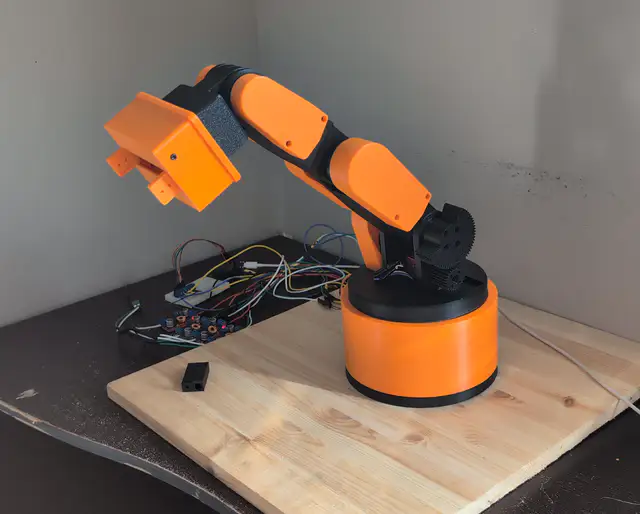
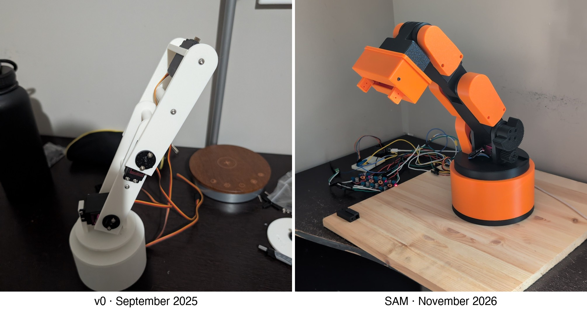
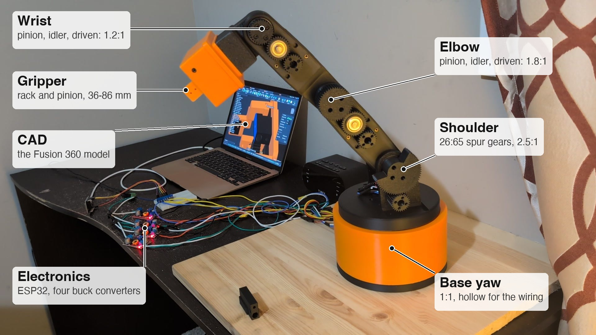

# S.A.M

**Servo-Actuated Manipulator**: a 4-axis desktop robot arm that I designed, 3D-printed, wired and programmed from scratch.

<p align="center"></p>

<p align="center">
  <a href="#videos">▶ Videos</a> ·
  <a href="https://www.youtube.com/watch?v=F5q1DYrK8Ag">YouTube</a> ·
  <a href="https://a360.co/4irzr3U">3D model in browser</a>
</p>

## Background

v0, in September 2025, was my first attempt at designing hardware from scratch. I didn't know CAD, what clean design
looks like, how cantilevers behave, how to make a joint, or how to wire anything. I was a complete newcomer.

From April 2026 I built version after version. By then I could model anything I wanted, so the hard part became
taste: making it look clean took a lot of trial and error. Planning was the other lesson. By the time the base and
pitch joints were done, nothing had been planned for a gripper to mount to the wrist, and the wiring had nowhere to go.

This version, started in mid-September, changed how the joints are driven. Instead of 608 bearings on steel shafts,
each joint turns on a spigot inside a large bearing. The wiring runs through the middle of the bearings, so nothing
pulls on the wires as the arm moves. The spigots made assembly far easier, and the whole arm looks much cleaner. It
took a lot of late nights: print, test, change the CAD, try again.

<p align="center"></p>

SAM now does reliable pick and place. Next: vision and sensors in the gripper, and replacing the printed gears and
cheap servos, which cause the backlash and the occasional sloppy feel in motion.

## How it's built

<p align="center"></p>

SAM reaches 396 mm from the centre of its base to the fingertips. In theory it can hold about 0.8 kg at full reach
before a servo stalls. The wrist gives out first: its MG996R is the smallest servo in the arm and has the least
reduction (1.2:1). The arm was designed around carrying a 200 g phone.

An ESP32 runs the [firmware](firmware/arm_demo), which plans each motion as one smooth path through waypoints. A small
[browser control panel](tools/arm_ui) drives it over USB.

The electronics sit loose on the desk in the videos. I designed an enclosure for them, but got its measurements
wrong. Fixing the CAD, reprinting it and routing the wires back through the arm wasn't worth it for this version.

## Videos

**Full take**

https://github.com/user-attachments/assets/081c5017-23f9-41e5-9b6a-ca7de9287f4b

**With the gear covers off**

https://github.com/user-attachments/assets/037ef3bc-d8a8-45be-aa5d-755805266f90

<details>
<summary><b>Running it</b></summary>

Flash `firmware/arm_demo` to an ESP32 with the Arduino IDE or `arduino-cli` (ESP32 Arduino core 3.x). The firmware
also takes commands directly in a serial monitor at 115200 baud; type `p` to list the joints. For the panel:

```
pip install -r tools/arm_ui/requirements.txt
python3 tools/arm_ui/arm_ui.py --port <your ESP32's serial port>
```

Then open http://127.0.0.1:8765.
</details>
